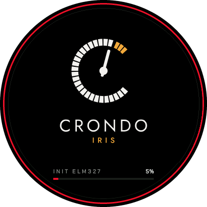
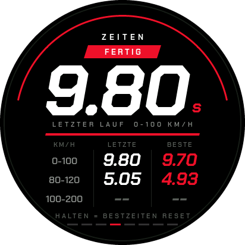
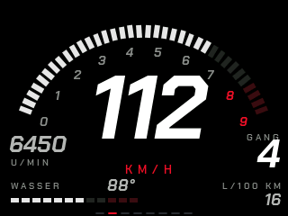

# CRONDO – Downloads

  

**Klein, rund, Charakter: Dein Cockpit sieht endlich nach dir aus.**

Dein Auto zeigt seine Werte auf einem kleinen Display – Geschwindigkeit, Drehzahl, Temperaturen, Verbrauch, Beschleunigungszeiten und Fehlercodes im Klartext. Eingerichtet wird alles einmal am PC, danach steckst du nur noch den Strom an.

> **Stand: Alpha.** Hier liegen Testpakete für Tester, kein Verkauf. Funktionen ändern sich noch, Fehler sind möglich – bitte melden (siehe „Wenn etwas nicht läuft").

---

## Was dein Auto dir endlich zeigt

- **Alles im Blick:** Geschwindigkeit, Drehzahl, Kühlwasser, Ansaugluft, Bordspannung, Momentanverbrauch, eingelegter Gang.
- **Warmlauf im Blick:** die Kühlwassertemperatur aus dem Kühlkreislauf, dazu der Hinweis, bis zu welcher Drehzahl du kalt fahren solltest, und ab 75 °C „BETRIEBSWARM".
- **Zeiten, die von allein messen:** 0–100, 80–120, 100–200. Du musst nichts starten – nur auf abgesperrtem Gelände fahren.
- **Fehlercodes im Klartext auf Deutsch:** lesen, verstehen, direkt am Gerät löschen. Nicht nur eine Nummer.
- **Fahrt im Rückblick:** Höchstwerte und verbrauchter Kraftstoff seit dem Start.

---

## Die Seiten

  
  
  

**Motor** zeigt die **Kühlwassertemperatur aus dem Kühlkreislauf** – nicht die Öltemperatur; die zeigt unser Display nicht. An der Kühlwassertemperatur erkennst du den Warmlauf: „BETRIEBSWARM" heißt ab 75 °C Kühlwasser (Standardwert, die Grenze lässt sich anpassen), davor steht der Hinweis, bis zu welcher Drehzahl du kalt fahren solltest. Dazu Ansauglufttemperatur und Bordspannung. **HUD** ist die Fahrseite: Geschwindigkeit groß, Drehzahl oben, Verbrauch, Gang und Kühlwasser im Blick. **Drehzahl & Gas** zeigt Pedalstellung und die höchste Drehzahl dieser Fahrt.

  
  
  

**Zeiten** misst Beschleunigungsläufe automatisch und merkt sich deine Bestzeit. **Fehlercodes** kommen im Klartext, löschen geht am Gerät. In den **Einstellungen** wechselst du Akzentfarbe, Fahrzeug und Adapter – ohne PC.

---

## Zwei Größen, eine Software

**Iris** ist rund (1,46″, 412 × 412), **Prism** ist eckig (2,8″). Beide zeigen dieselben Seiten, dasselbe Verhalten, dieselben Themes – nur in einer anderen Form. Jedes Gerät bekommt sein eigenes Firmware-Paket.

  

---

## Elf Themes – nicht nur eine andere Farbe

Jedes Theme ändert das ganze Display: Schriften, Farben, Zeiger, Hintergründe. **Minimal** ist ab Werk eingestellt und liegt immer auf dem Gerät. Dazu kommen **Classic**, **All-out**, **Bunny**, **Wings**, **Flames**, **Neon Drive**, **Heritage**, **Blueprint**, **Terrain** und **Bloom** – elf Themes für beide Geräte. Die Akzentfarbe (acht Farben) stellst du unabhängig vom Theme ein, am Gerät oder in Studio. Die Themes und ihre Änderungen stehen in [`themes/README.md`](themes/README.md).

  
  
  

Themes liegen hier als Paket und werden über Studio aufs Display gespielt. Das Display prüft dabei die Signatur des Pakets und nimmt nichts Ungeprüftes an.

---

## Einrichten

1. **Display und Adapter besorgen.** Für Iris ein Waveshare ESP32-S3-Touch-LCD-1.46B (rund, 1,46″, 412 × 412), für Prism ein ESP32-S3-Touch-LCD-2.8. Dazu einen OBD-Adapter mit **Bluetooth LE** (Bluetooth 4.0 oder neuer) – ältere Adapter mit klassischem Bluetooth funktionieren nicht. Dazu ein USB-C-Datenkabel und ein Halter. Board, Adapter und Halter kaufst du selbst; das hält den Preis niedrig.
2. **CRONDO Studio installieren** (Windows 10/11, 64 Bit). Die Setup-Datei liegt als Release hier im Repo – als Tester bekommst du den Link mit deinem Zugang. Windows meldet beim Start „unbekannter Herausgeber“ (die Datei ist nicht signiert, in der Alpha so vorgesehen); Einzelheiten in [`studio/README.md`](studio/README.md).
3. **Firmware aufspielen.** Display mit dem Datenkabel an den PC, Studio starten, Reiter „Firmware", passendes Paket wählen, aufspielen. Das Gerät startet danach selbst neu. **Während des Aufspielens nicht trennen** – bricht es ab, lieber noch einmal aufspielen als abziehen.
4. **Adapter einstecken, fertig.** Steck den Bluetooth-Adapter in die OBD-Buchse und schalte das Display ein: Es sucht den Adapter selbst und merkt ihn sich. Beim nächsten Start verbindet es sich von allein.

  
  

Dein Auto braucht eine OBD-II-Buchse (in der EU Pflicht bei Benzinern ab 2001, Diesel ab 2004). Was dein Auto liefert, entscheidet der Hersteller – fehlt ein Wert, zeigt das Display `--`. Ohne Fahrzeugprofil funktioniert alles, nur die Ganganzeige fehlt.

<b>Technische Angaben (für Neugierige)</b>

Dieses Repo enthält nur fertige Pakete, keinen Quelltext (ADR 0008).

| Pfad | Inhalt |
|---|---|
| `firmware/<gerät>/<board>/<version>/` | Firmware-Paket (`.crondo`) je Gerät und Version, z. B. `firmware/iris/ws146b/0.4.0-alpha.11/0.4.0-alpha.11.crondo` |
| `themes/` | Theme-Pakete (`.theme`) mit Signatur (`.theme.sig`) und Versionsstempel, Changelog in `themes/README.md` |
| `profiles/` | Fahrzeugprofile je Hersteller/Modell/Baujahr/Motor, Changelog in `profiles/README.md` |
| `latest/themes.json`, `latest/profiles.json` (+ `.sig`) | signierte Kataloge, die Studio liest |
| `studio/` | Hinweise zu CRONDO Studio; die Setup-Datei liegt als Release-Asset (rund 47 MB), Changelog in `studio/README.md` |

Geräte und Boards: **Iris** = `ws146b`, **Prism** = `ws28`. Firmware-Pakete sind signiert und werden vor dem Aufspielen geprüft; ein Paket für ein anderes Board wird abgelehnt. Fahrzeugprofil, Einstellungen und Bestzeiten bleiben beim Firmware-Wechsel erhalten. Studio lädt aus diesem Repo nur den Theme-Katalog und die Update-Seite – ohne Konto, ohne Kennung.

---

## Updates und Rückweg

Neue Versionen erscheinen hier, ältere bleiben liegen – du kannst also jederzeit zurück: gleicher Weg wie beim Update, nur die ältere Version wählen.
- **Firmware:** ältere Version im Reiter „Firmware“ wählen. Profile und Einstellungen bleiben erhalten.
- **Studio:** ältere Setup-Datei aus den Releases installieren; sie ersetzt die neuere.
- **Themes:** jederzeit wechselbar, `minimal` bleibt immer auf dem Gerät.

## Changelog

Jedes Paket hat seinen eigenen Changelog dort, wo es liegt:

- **Firmware** (Iris, Prism): [`firmware/README.md`](firmware/README.md#changelog-firmware)
- **Themes** (Pakete und Katalog): [`themes/README.md`](themes/README.md#changelog-katalog)
- **CRONDO Studio** (Windows): [`studio/README.md`](studio/README.md#changelog-studio)
- **Fahrzeugprofile**: [`profiles/README.md`](profiles/README.md#changelog)

## Wenn etwas nicht läuft

1. Studio starten, Reiter **„Support"**.
2. **Support-Paket erstellen** – eine Datei mit Sicherung und Logs, etwa 64 kB. Studio zeigt vorher als Liste, was drin ist.
3. Die Datei an die Adresse schicken, die du mit deinem Tester-Zugang bekommen hast.

Kein Wert zu sehen? Meist liegt es am Adapter: Zündung an, Adapter fest eingesteckt, wirklich Bluetooth LE, keine Handy-App gleichzeitig verbunden.

## Rechtliches

- **Lizenztexte:** im Studio-Paket als `LIZENZEN.txt` (enthält unter anderem die LGPL-Hinweise zu Qt).
- **Datenschutz:** Die Firmware sendet nichts. Studio lädt nur Theme-Katalog und Update-Seite – ohne Konto, ohne Kennung, ohne Tracking, ohne Cookies. Auf deinem PC gespeichert werden nur Einstellungen, gesicherte Logs und Profile.
- Verkauf, Preise, AGB und Widerruf sind nicht Teil dieses Repos; sie stehen auf crondo.app, sobald der Auftritt online ist.
