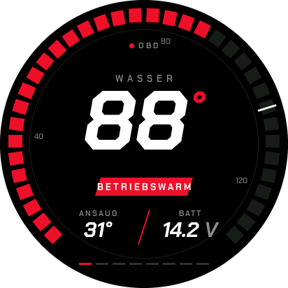
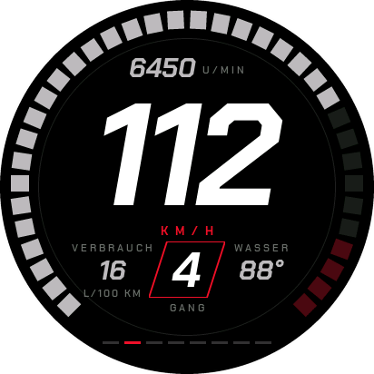
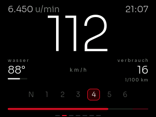
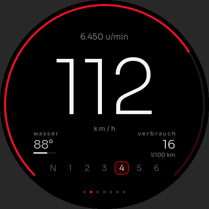
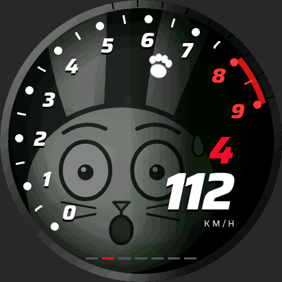
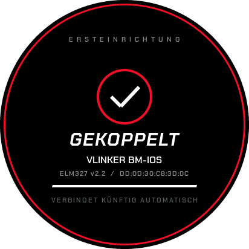
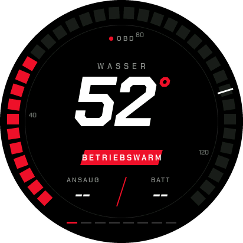

# CRONDO – Downloads

  

**Klein, rund, Charakter: Dein Cockpit sieht endlich nach dir aus.**

CRONDO zeigt dir, was dein Auto über die Diagnosebuchse hergibt: Geschwindigkeit, Drehzahl, Temperaturen, Verbrauch, Beschleunigungszeiten und Fehlercodes im Klartext. Eingerichtet wird es einmal am PC, danach steckst du nur noch den Strom an.

> **Stand: Alpha.** Hier liegen Testpakete für Tester, kein Verkauf. Funktionen ändern sich noch, Fehler sind möglich – bitte melden (siehe „Wenn etwas nicht läuft").

---

## Was dein Auto dir endlich zeigt

- **Alles im Blick:** Geschwindigkeit, Drehzahl, Kühlwasser, Ansaugluft, Bordspannung, Momentanverbrauch und den eingelegten Gang.
- **Warmlauf statt Rätselraten:** die Kühlwassertemperatur aus dem Kühlkreislauf, dazu der Hinweis, bis zu welcher Drehzahl du kalt fahren solltest – ab 75 °C steht dort „BETRIEBSWARM".
- **Zeiten, die von allein messen:** 0–100, 80–120, 100–200. Du musst nichts starten, die Bestzeit bleibt gespeichert. Bitte nur auf abgesperrtem Gelände.
- **Fehlercodes im Klartext auf Deutsch:** lesen, verstehen, am Gerät löschen. Nicht nur eine Nummer.
- **Passt zu deinem Auto:** über 250 Fahrzeugprofile liegen bereit. Und ohne Profil läuft trotzdem alles – nur die Ganganzeige fehlt.

---

## Die Seiten

  
  
  

**Motor** zeigt die Kühlwassertemperatur aus dem Kühlkreislauf – nicht die Öltemperatur, die liefert unser Display nicht. Dazu Ansaugluft und Bordspannung, und beim Kaltstart den Hinweis, bis zu welcher Drehzahl du warmfahren solltest.

**HUD** ist die Fahrseite: Geschwindigkeit groß, Drehzahl oben, Verbrauch, Gang und Kühlwasser im Blick. **Drehzahl & Gas** zeigt die Pedalstellung und die höchste Drehzahl dieser Fahrt.

  
  
  

**Zeiten** misst Beschleunigungsläufe automatisch und merkt sich deine Bestzeit. **Fehlercodes** kommen im Klartext, gelöscht wird direkt am Gerät. In den **Einstellungen** wechselst du Akzentfarbe, Fahrzeug und Adapter – ohne PC.

---

## Zwei Größen, eine Software

**Iris** ist rund (1,46″, 412 × 412), **Prism** ist eckig (2,8″). Beide zeigen dieselben Seiten, dasselbe Verhalten und dieselben Themes – nur in einer anderen Form. Jedes Gerät bekommt sein eigenes Firmware-Paket.

  

---

## Elf Themes – nicht nur eine andere Farbe

Ein Theme ändert das ganze Display: Schriften, Farben, Zeiger, Hintergründe. **Minimal** ist ab Werk eingestellt und liegt immer auf dem Gerät – es ist die Rückfallebene. Dazu kommen **Classic**, **All-out**, **Bunny**, **Wings**, **Flames**, **Neon Drive**, **Heritage**, **Blueprint**, **Terrain** und **Bloom**, alle für beide Geräte. Was jedes Theme ausmacht, steht in [`themes/README.md`](themes/README.md).

  
  
  
  

Themes liegen hier als Paket und werden über Studio aufs Display gespielt. Das Display prüft ein Theme, bevor es das annimmt. Die **Akzentfarbe** aus acht Farben stellst du unabhängig vom Theme ein, am Gerät oder in Studio.

---

## Was du brauchst

Die Hardware kaufst du selbst – so bekommst du Originalware vom Hersteller, und wir halten keinen Lagerbestand.

| Teil | Was genau | Hinweis |
|---|---|---|
| **Display (Iris)** | Waveshare **ESP32-S3-Touch-LCD-1.46B** – rund, 1,46″, 412 × 412, mit Touch | genau dieses Modell |
| **Display (Prism)** | Waveshare **ESP32-S3-Touch-LCD-2.8** – eckig, 2,8″, mit Touch | **Touch-Variante V2** (es gibt zwei; nur V2 wird unterstützt) |
| **OBD-Adapter** | Bluetooth-**LE**-Adapter (Bluetooth 4.0 oder neuer), ELM327-kompatibel | klassisches Bluetooth ohne „LE" funktioniert **nicht** |
| **USB-C-Kabel** | Datenkabel, kein reines Ladekabel | für Einrichtung und Strom im Auto |
| **Strom im Auto** | USB-Buchse des Radios oder 12-V-USB-Adapter | Radio-USB schaltet meist mit der Zündung ab |
| **Windows-PC** | einmalig zum Einrichten | danach nur für Updates und neue Profile |
| **Halter** | zur Montage im Auto | in Entwicklung; zum Testen reicht eine provisorische Befestigung |

Dein Auto braucht eine **OBD-II-Buchse** – in der EU bei Benzinern ab Baujahr 2001, bei Dieseln ab 2004. Welche Werte dein Auto liefert, entscheidet der Hersteller: fehlt einer, zeigt das Display `--`.

## Getestet

| Display | Stand |
|---|---|
| Iris (Waveshare 1.46B) | im Einsatz, Oberfläche und Touch geprüft |
| Prism (Waveshare 2.8, Touch V2) | zwei Geräte im Einsatz, Oberfläche und Touch geprüft |

| OBD-Adapter | Stand |
|---|---|
| **vLinker BM+** (iOS-Ausführung) | im Auto geprüft, verbindet sich zuverlässig |
| **Vgate iCar Pro** | läuft dauerhaft im Testfahrzeug (Hyundai ix35), seit Wochen ohne Aussetzer |

Andere Displays werden nicht unterstützt. Bei Adaptern gilt: Bluetooth LE und ELM327-kompatibel – dann klappt es in der Regel. Sicher geprüft sind die beiden oben, für alles andere gibt es keine Zusage.

## Einrichten

1. **Display und Adapter besorgen** – Liste und Hinweise stehen unter „Was du brauchst". Board, Adapter und Halter kaufst du selbst; das hält den Preis niedrig.
2. **CRONDO Studio installieren** (Windows 10/11, 64 Bit). Die Setup-Datei findest du unter **Releases**; als Tester bekommst du den Link mit deinem Zugang. Windows meldet beim Start „unbekannter Herausgeber" – die Datei ist in der Alpha bewusst nicht signiert; Einzelheiten in [`studio/README.md`](studio/README.md).
3. **Firmware aufspielen.** Display mit dem Datenkabel an den PC, Studio starten, Reiter „Firmware", passendes Paket wählen, aufspielen. Das Gerät startet danach selbst neu. **Während des Aufspielens nicht trennen** – bricht es ab, lieber noch einmal aufspielen als abziehen.
4. **Adapter einstecken, fertig.** Steck den Bluetooth-Adapter in die OBD-Buchse und schalte das Display ein: Es sucht den Adapter selbst und merkt ihn sich. Beim nächsten Start verbindet es sich von allein.

  
  

<b>Technische Angaben (für Neugierige)</b>

| Ordner | Inhalt |
|---|---|
| `firmware/` | Firmware-Pakete je Gerät und Version, mit Changelog |
| `themes/` | Theme-Pakete, mit Changelog |
| `profiles/` | Fahrzeugprofile, mit Changelog |
| `studio/` | Hinweise und Changelog zu CRONDO Studio; die Setup-Datei liegt beim Release |

Nimm immer das Paket, das zu deinem Gerät passt (Iris oder Prism) – ein Paket für das andere Gerät wird abgelehnt. Firmware-Pakete werden vor dem Aufspielen geprüft.

---

## Updates und Rückweg

Neue Versionen erscheinen hier, ältere bleiben liegen. Du kannst also jederzeit zurück – gleicher Weg wie beim Update, nur die ältere Version wählen.

- **Firmware:** ältere Version im Reiter „Firmware" wählen. Profile und Einstellungen bleiben erhalten.
- **Studio:** ältere Setup-Datei aus den Releases installieren; sie ersetzt die neuere.
- **Themes:** jederzeit wechselbar, `minimal` bleibt immer auf dem Gerät.

## Noch in Arbeit

- **Halter und Gehäuse** werden gedruckt; Dateien und Hinweise kommen mit dem Tester-Zugang.
- **Zwei oder drei Displays an einem Auto** (ein Display liest, die anderen zeigen dieselben Werte) – in Arbeit, noch nicht verfügbar.
- **Updates ohne Kabel** über WLAN – geplant.
- **Handy-App** für Einstellungen und Updates – geplant, Zeitpunkt offen.

## Changelog

Jedes Paket hat seinen eigenen Changelog dort, wo es liegt:

- **Firmware** (Iris, Prism): [`firmware/README.md`](firmware/README.md#changelog)
- **Themes**: [`themes/README.md`](themes/README.md#neu-dazu)
- **CRONDO Studio** (Windows): [`studio/README.md`](studio/README.md#changelog)
- **Fahrzeugprofile**: [`profiles/README.md`](profiles/README.md#neu-dazu)

## Wenn etwas nicht läuft

1. Studio starten, Reiter **„Support"**.
2. **Support-Paket erstellen** – eine Datei mit Sicherung und Logs, etwa 64 kB. Studio zeigt vorher als Liste, was drin ist.
3. Die Datei an die Adresse schicken, die du mit deinem Tester-Zugang bekommen hast.

Kein Wert zu sehen? Meist liegt es am Adapter: Zündung an, Adapter fest eingesteckt, wirklich Bluetooth LE, keine Handy-App gleichzeitig verbunden.

## Rechtliches

- **Lizenztexte:** im Studio-Paket als `LIZENZEN.txt` (enthält unter anderem die LGPL-Hinweise zu Qt).
- **Datenschutz:** Die Firmware sendet nichts. Studio lädt nur die Theme-Liste und die Update-Seite – ohne Konto, ohne Kennung, ohne Tracking, ohne Cookies. Auf deinem PC gespeichert werden nur Einstellungen, gesicherte Logs und Profile.
- Verkauf, Preise, AGB und Widerruf stehen auf crondo.app, sobald der Auftritt online ist.
