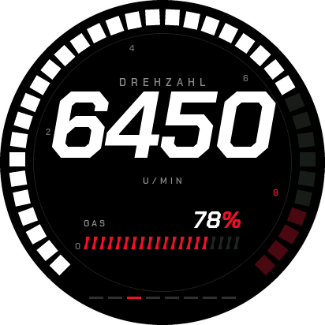
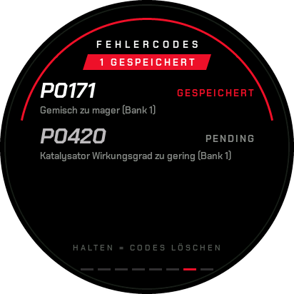
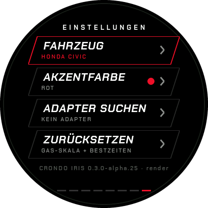
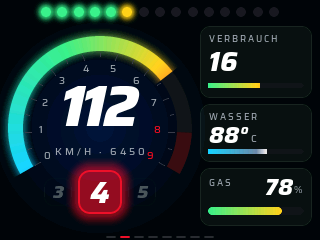

# CRONDO

  

  <b>Klein, rund, Charakter: Dein Cockpit sieht endlich nach dir aus.</b> 
  Dein Auto zeigt seine Werte auf einem kleinen Touchdisplay – kabellos über einen Bluetooth-Adapter, eingerichtet einmal am PC.

  
  
  
  

> **Alpha:** Hier liegen Testpakete für Tester, kein Verkauf. Funktionen ändern sich noch, Fehler sind möglich – bitte melden (siehe [Wenn etwas nicht läuft](#wenn-etwas-nicht-läuft)).

---

## Drei Dinge, die du sofort merkst

- **Kein Kabel zum OBD-Port.** Die Werte kommen per Bluetooth-Adapter; Strom kommt über USB aus der Radio-Buchse.
- **Fehlercodes auf Deutsch.** Kein Zahlenraten: Klartext, lesen und direkt am Gerät löschen.
- **Elf Themes, acht Akzentfarben.** Das Display sieht aus, wie du willst – nicht wie ein Bastelprojekt.

---

## So sieht es aus

<table>
  <tr>
    <td align="center" width="33%">
       
      <b>HUD</b> 
      Tempo groß, Drehzahl oben, Verbrauch, Gang und Kühlwasser im Blick.
    </td>
    <td align="center" width="33%">
       
      <b>Motor</b> 
      Kühlwasser aus dem Kühlkreislauf, Ansaugluft, Bordspannung – und ob du warmfahren solltest.
    </td>
    <td align="center" width="33%">
       
      <b>Drehzahl &amp; Gas</b> 
      Pedalstellung in Prozent und die höchste Drehzahl dieser Fahrt.
    </td>
  </tr>
  <tr>
    <td align="center">
       
      <b>Zeiten</b> 
      0–100, 80–120, 100–200 – messen von allein, die Bestzeit bleibt gespeichert.
    </td>
    <td align="center">
       
      <b>Fehlercodes</b> 
      Gespeicherte Codes mit Klartext, löschen direkt am Gerät.
    </td>
    <td align="center">
       
      <b>Einstellungen</b> 
      Akzentfarbe, Fahrzeug und Adapter wechseln – ohne PC.
    </td>
  </tr>
</table>

---

## Zwei Größen, eine Software

<table>
  <tr>
    <td align="center" width="50%">
       
      <b>Iris</b> 
      rund · 1,46″ · 412 × 412
    </td>
    <td align="center" width="50%">
       
      <b>Prism</b> 
      eckig · 2,8″ · quer eingebaut
    </td>
  </tr>
</table>

Dieselben Seiten, dasselbe Verhalten, dieselben Themes – nur in einer anderen Form. Jedes Gerät bekommt sein eigenes Firmware-Paket.

---

## Elf Themes – nicht nur eine andere Farbe

Ein Theme ändert das ganze Display: Schriften, Farben, Zeiger, Hintergründe. **Minimal** ist ab Werk eingestellt und liegt immer auf dem Gerät – es ist die Rückfallebene. Dazu kommen **Classic**, **All-out**, **Bunny**, **Wings**, **Flames**, **Neon Drive**, **Heritage**, **Blueprint**, **Terrain** und **Bloom**. Was jedes Theme ausmacht, steht in [`themes/README.md`](themes/README.md).

<table>
  <tr>
    <td align="center" width="25%"> Minimal</td>
    <td align="center" width="25%"> Classic</td>
    <td align="center" width="25%"> All-out</td>
    <td align="center" width="25%"> Bunny</td>
  </tr>
</table>

Themes liegen hier als Paket und werden über Studio aufs Display gespielt. Das Display prüft ein Theme, bevor es das annimmt. Die **Akzentfarbe** aus acht Farben stellst du unabhängig vom Theme ein, am Gerät oder in Studio.

---

## Was du brauchst

Die Hardware kaufst du selbst – so bekommst du Originalware vom Hersteller, und wir halten keinen Lagerbestand.

| Teil | Was genau | Hinweis |
|---|---|---|
| **Display (Iris)** | Waveshare **ESP32-S3-Touch-LCD-1.46B** – rund, 1,46″, 412 × 412, mit Touch | genau dieses Modell |
| **Display (Prism)** | Waveshare **ESP32-S3-Touch-LCD-2.8** – eckig, 2,8″, mit Touch | **Touch-Variante V2** (es gibt zwei; nur V2 wird unterstützt) |
| **OBD-Adapter** | Bluetooth-**LE**-Adapter (Bluetooth 4.0 oder neuer), ELM327-kompatibel | klassisches Bluetooth ohne „LE" funktioniert **nicht** |
| **USB-C-Kabel** | Datenkabel, kein reines Ladekabel | für Einrichtung und Strom im Auto |
| **Strom im Auto** | USB-Buchse des Radios oder 12-V-USB-Adapter | Radio-USB schaltet meist mit der Zündung ab |
| **Windows-PC** | einmalig zum Einrichten | danach nur für Updates und neue Profile |
| **Halter** | zur Montage im Auto | in Entwicklung; zum Testen reicht eine provisorische Befestigung |

Dein Auto braucht eine **OBD-II-Buchse** – in der EU bei Benzinern ab Baujahr 2001, bei Dieseln ab 2004. Welche Werte dein Auto liefert, entscheidet der Hersteller: fehlt einer, zeigt das Display `--`.

## Getestet

| Display | Stand |
|---|---|
| Iris (Waveshare 1.46B) | im Einsatz, Oberfläche und Touch geprüft |
| Prism (Waveshare 2.8, Touch V2) | zwei Geräte im Einsatz, Oberfläche und Touch geprüft |

| OBD-Adapter | Stand |
|---|---|
| **vLinker BM+** | im Auto geprüft, verbindet sich zuverlässig |
| **Vgate iCar Pro** | Dauerbetrieb im Testfahrzeug, seit Wochen ohne Aussetzer |

| Testfahrzeug | Was dort geprüft ist |
|---|---|
| **Honda Civic Type R (FN2, 2007–2011)** | Ersteinrichtung, alle Seiten, Fehlercodes und Zeiten im Fahrbetrieb; Profil bestätigt |
| **Hyundai ix35 2.0 4WD (2010–2015)** | Dauerbetrieb über Wochen, Profil bestätigt |

Geprüft heißt: an genau diesen Autos getestet – keine Freigabe für alle Modelle. Dein Auto braucht nur die OBD-II-Buchse; was es nicht liefert, zeigt das Display als `--`. Andere Displays werden nicht unterstützt; bei Adaptern gilt Bluetooth LE und ELM327-kompatibel, sicher geprüft sind aber nur die beiden oben.

---

## In vier Schritten startklar

<table>
  <tr>
    <td align="center" valign="top" width="25%"><b>1</b> <b>Besorgen</b> Display, Adapter, USB-C-Datenkabel, Halter – Liste oben.</td>
    <td align="center" valign="top" width="25%"><b>2</b> <b>Studio installieren</b> Windows 10/11. Die Setup-Datei liegt unter Releases; „unbekannter Herausgeber" ist in der Alpha normal.</td>
    <td align="center" valign="top" width="25%"><b>3</b> <b>Firmware aufspielen</b> Display ans Kabel, im Reiter „Firmware" das Paket für dein Gerät wählen, warten.</td>
    <td align="center" valign="top" width="25%"><b>4</b> <b>Adapter einstecken</b> Anschalten, das Display sucht und merkt ihn sich – ab dann verbindet es allein.</td>
  </tr>
</table>

  
  

**Zwei Hinweise, die Ärger sparen:** Die Setup-Datei ist in der Alpha bewusst nicht signiert, deshalb fragt Windows beim ersten Start nach – Einzelheiten in [`studio/README.md`](studio/README.md). Und beim Aufspielen **das Kabel nicht trennen**: bricht es ab, lieber noch einmal aufspielen als abziehen.

<b>Technische Angaben (für Neugierige)</b>

| Ordner | Inhalt |
|---|---|
| `firmware/` | Firmware-Pakete je Gerät und Version, mit Changelog |
| `themes/` | Theme-Pakete, mit Changelog |
| `profiles/` | Fahrzeugprofile, mit Changelog |
| `studio/` | Hinweise und Changelog zu CRONDO Studio; die Setup-Datei liegt beim Release |

Nimm immer das Paket, das zu deinem Gerät passt (Iris oder Prism) – ein Paket für das andere Gerät wird abgelehnt. Firmware-Pakete werden vor dem Aufspielen geprüft.

---

## Updates und Rückweg

Neue Versionen erscheinen hier, ältere bleiben liegen. Du kannst also jederzeit zurück – gleicher Weg wie beim Update, nur die ältere Version wählen.

| Was | Rückweg |
|---|---|
| **Firmware** | ältere Version im Reiter „Firmware" wählen – Profile und Einstellungen bleiben erhalten |
| **Studio** | ältere Setup-Datei aus den Releases installieren; sie ersetzt die neuere |
| **Themes** | jederzeit wechselbar, `minimal` bleibt immer auf dem Gerät |

## Noch in Arbeit

| Was | Stand |
|---|---|
| **Halter und Gehäuse** | werden gedruckt; Dateien und Hinweise kommen mit dem Tester-Zugang |
| **Zwei oder drei Displays an einem Auto** | in Arbeit – ein Display liest, die anderen zeigen dieselben Werte |
| **Updates ohne Kabel** | geplant, über WLAN |
| **Handy-App** für Einstellungen und Updates | geplant, Zeitpunkt offen |

## Changelog

| Paket | Wo |
|---|---|
| **Firmware** (Iris, Prism) | [`firmware/README.md`](firmware/README.md#changelog) |
| **Themes** | [`themes/README.md`](themes/README.md#neu-dazu) |
| **CRONDO Studio** | [`studio/README.md`](studio/README.md#changelog) |
| **Fahrzeugprofile** | [`profiles/README.md`](profiles/README.md#neu-dazu) |

## Wenn etwas nicht läuft

1. Studio starten, Reiter **„Support"**.
2. **Support-Paket erstellen** – eine Datei mit Sicherung und Logs, etwa 64 kB. Studio zeigt vorher als Liste, was drin ist.
3. Die Datei an die Adresse schicken, die du mit deinem Tester-Zugang bekommen hast.

Kein Wert zu sehen? Meist liegt es am Adapter: Zündung an, Adapter fest eingesteckt, wirklich Bluetooth LE, keine Handy-App gleichzeitig verbunden.

## Rechtliches

- **Lizenztexte:** im Studio-Paket als `LIZENZEN.txt` (enthält unter anderem die LGPL-Hinweise zu Qt).
- **Datenschutz:** Die Firmware sendet nichts. Studio lädt nur die Theme-Liste und die Update-Seite – ohne Konto, ohne Kennung, ohne Tracking, ohne Cookies. Auf deinem PC gespeichert werden nur Einstellungen, gesicherte Logs und Profile.
- Verkauf, Preise, AGB und Widerruf stehen auf crondo.app, sobald der Auftritt online ist.
