# CRONDO – Downloads

  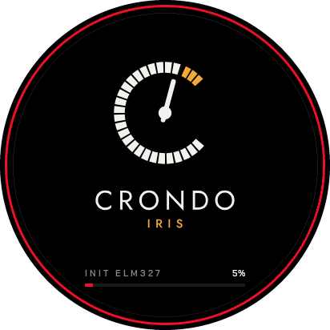

**Klein, rund, Charakter: Dein Cockpit sieht endlich nach dir aus.**

Dein Auto zeigt seine Werte auf einem kleinen Display – Geschwindigkeit, Drehzahl, Temperaturen, Verbrauch, Beschleunigungszeiten und Fehlercodes im Klartext. Eingerichtet wird alles einmal am PC, danach steckst du nur noch den Strom an.

> **Stand: Alpha.** Hier liegen Testpakete für Tester, kein Verkauf. Funktionen ändern sich noch, Fehler sind möglich – bitte melden (siehe „Wenn etwas nicht läuft").

---

## Was dein Auto dir endlich zeigt

- **Alles im Blick:** Geschwindigkeit, Drehzahl, Kühlwasser, Ansaugluft, Bordspannung, Momentanverbrauch, eingelegter Gang.
- **Warmfahren ohne Rästelraten:** Das Display sagt dir, bis zu welcher Drehzahl du kalt fahren solltest, und meldet „BETRIEBSWARM".
- **Zeiten, die von allein messen:** 0–100, 80–120, 100–200. Du musst nichts starten – nur auf abgesperrtem Gelände fahren.
- **Fehlercodes im Klartext auf Deutsch:** lesen, verstehen, direkt am Gerät löschen. Nicht nur eine Nummer.
- **Fahrt im Rückblick:** Höchstwerte und verbrauchter Kraftstoff seit dem Start.

---

## Die Seiten

  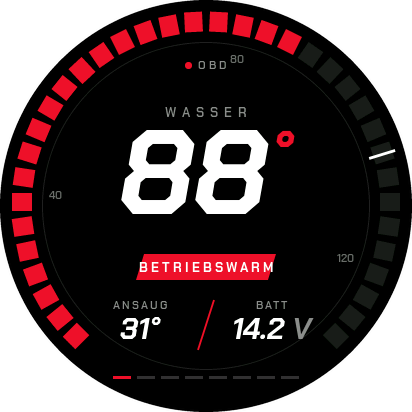
  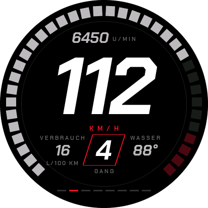
  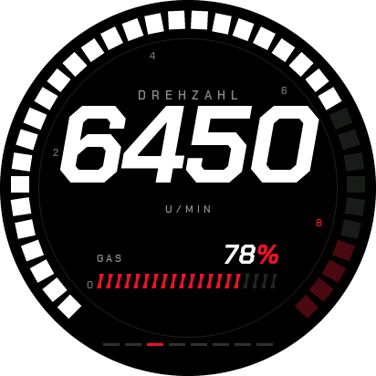

**Motor** zeigt, ob dein Auto warm ist. **HUD** ist die Fahrseite: Geschwindigkeit groß, Drehzahl oben, Verbrauch, Gang und Kühlwasser im Blick. **Drehzahl & Gas** zeigt Pedalstellung und die höchste Drehzahl dieser Fahrt.

  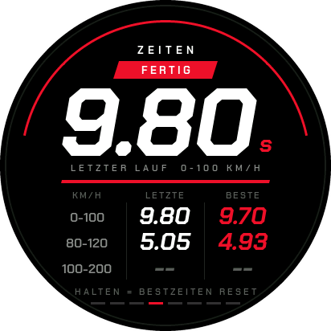
  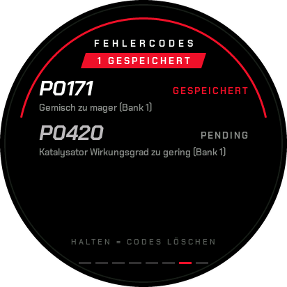
  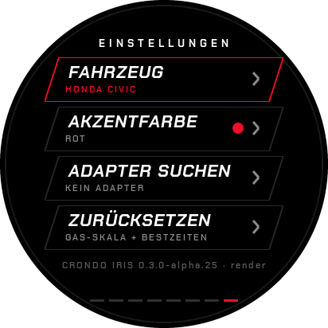

**Zeiten** misst Beschleunigungsläufe automatisch und merkt sich deine Bestzeit. **Fehlercodes** kommen im Klartext, löschen geht am Gerät. In den **Einstellungen** wechselst du Akzentfarbe, Fahrzeug und Adapter – ohne PC.

---

## Zwei Größen, eine Software

**Iris** ist rund (1,46″, 412 × 412), **Prism** ist eckig (2,8″). Beide zeigen dieselben Seiten, dasselbe Verhalten, dieselben Themes – nur in einer anderen Form. Jedes Gerät bekommt sein eigenes Firmware-Paket.

  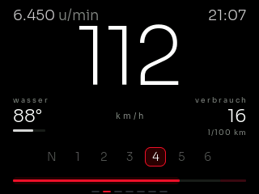

---

## Fünf Themes – nicht nur eine andere Farbe

Jedes Theme ändert das ganze Display: Schriften, Farben, Zeiger, Hintergründe. **Minimal** ist ab Werk eingestellt, dazu kommen **Classic**, **All-out**, **Bunny** und **Flames**. Die Akzentfarbe (acht Farben) stellst du unabhängig vom Theme ein, am Gerät oder in Studio.

  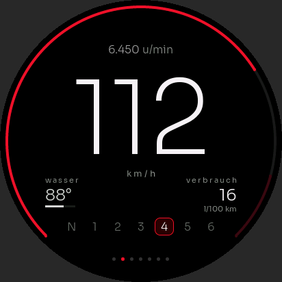
  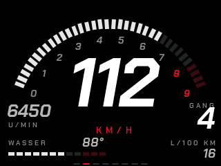
  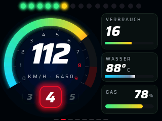

Themes liegen hier als Paket und werden über Studio aufs Display gespielt. Das Display prüft dabei die Signatur des Pakets und nimmt nichts Ungeprüftes an.

---

## Einrichten

1. **Display und Adapter besorgen.** Für Iris ein Waveshare ESP32-S3-Touch-LCD-1.46B (rund, 1,46″, 412 × 412), für Prism ein ESP32-S3-Touch-LCD-2.8. Dazu einen OBD-Adapter mit **Bluetooth LE** (Bluetooth 4.0 oder neuer) – ältere Adapter mit klassischem Bluetooth funktionieren nicht. Dazu ein USB-C-Datenkabel und ein Halter. Board, Adapter und Halter kaufst du selbst; das hält den Preis niedrig.
2. **CRONDO Studio installieren** (Windows 10/11, 64 Bit). Den Download gibt es auf crondo.app, sobald der Auftritt online ist – als Tester bekommst du den Link mit deinem Zugang. Windows meldet beim ersten Start, dass die App nicht signiert ist: Das ist bekannt, über **Weitere Informationen → Trotzdem ausführen** geht es weiter. Studio braucht kein Konto.
3. **Firmware aufspielen.** Display mit dem Datenkabel an den PC, Studio starten, Reiter „Firmware", passendes Paket wählen, aufspielen. Das Gerät startet danach selbst neu. **Während des Aufspielens nicht trennen** – bricht es ab, lieber noch einmal aufspielen als abziehen.
4. **Adapter einstecken, fertig.** Steck den Bluetooth-Adapter in die OBD-Buchse und schalte das Display ein: Es sucht den Adapter selbst und merkt ihn sich. Beim nächsten Start verbindet es sich von allein.

  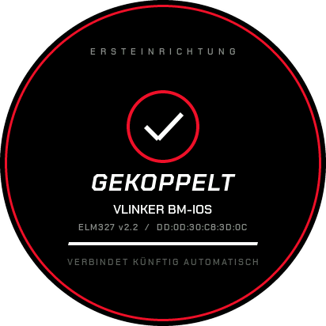
  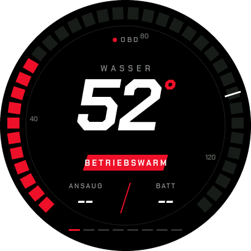

Dein Auto braucht eine OBD-II-Buchse (in der EU Pflicht bei Benzinern ab 2001, Diesel ab 2004). Was dein Auto liefert, entscheidet der Hersteller – fehlt ein Wert, zeigt das Display `--`. Ohne Fahrzeugprofil funktioniert alles, nur die Ganganzeige fehlt.

<b>Technische Angaben (für Neugierige)</b>

Dieses Repo enthält nur fertige Pakete, keinen Quelltext (ADR 0008).

| Pfad | Inhalt |
|---|---|
| `firmware/<gerät>/<board>/<version>/` | Firmware-Paket (`.crondo`) je Gerät und Version, z. B. `firmware/iris/ws146b/0.4.0-alpha.11/0.4.0-alpha.11.crondo` |
| `themes/` | Theme-Pakete (`.theme`) mit Signatur (`.theme.sig`) |
| `latest/themes.json` + `.sig` | signierter Theme-Katalog, den Studio liest |

Geräte und Boards: **Iris** = `ws146b`, **Prism** = `ws28`. Firmware-Pakete sind signiert und werden vor dem Aufspielen geprüft; ein Paket für ein anderes Board wird abgelehnt. Fahrzeugprofil, Einstellungen und Bestzeiten bleiben beim Firmware-Wechsel erhalten. Studio lädt aus diesem Repo nur den Theme-Katalog und die Update-Seite – ohne Konto, ohne Kennung.

---

## Updates und Rückweg

Neue Versionen erscheinen hier. Ältere bleiben liegen – du kannst also jederzeit zurück: gleicher Weg wie beim Update, nur die ältere Version wählen. Das ist sinnvoll, wenn eine neue Version bei dir einen Fehler zeigt, den die vorige nicht hatte. Einstellungen, Profil, Bestzeiten und Logs bleiben dabei erhalten.

## Changelog

| Version | Datum | Inhalt |
|---|---|---|
| 0.4.0-alpha.11 | 2026-11-10 | Theme-Pakete sind jetzt signiert: Das Display nimmt nur geprüfte Pakete an. Dazu eine Sperre, damit nicht zwei Programme gleichzeitig auf dasselbe Gerät zugreifen. |
| 0.4.0-alpha.10 | 2026-11-10 | Alle fünf Themes kommen als Paket statt fest in der Firmware: die Firmware wird kleiner, Themes lassen sich einzeln nachinstallieren und austauschen. |

## Wenn etwas nicht läuft

1. Studio starten, Reiter **„Support"**.
2. **Support-Paket erstellen** – eine Datei mit Sicherung und Logs, etwa 64 kB. Studio zeigt vorher als Liste, was drin ist.
3. Die Datei an die Adresse schicken, die du mit deinem Tester-Zugang bekommen hast.

Kein Wert zu sehen? Meist liegt es am Adapter: Zündung an, Adapter fest eingesteckt, wirklich Bluetooth LE, keine Handy-App gleichzeitig verbunden.

## Rechtliches

- **Lizenztexte:** im Studio-Paket als `LIZENZEN.txt` (enthält unter anderem die LGPL-Hinweise zu Qt).
- **Datenschutz:** Die Firmware sendet nichts. Studio lädt nur Theme-Katalog und Update-Seite – ohne Konto, ohne Kennung, ohne Tracking, ohne Cookies. Auf deinem PC gespeichert werden nur Einstellungen, gesicherte Logs und Profile.
- Verkauf, Preise, AGB und Widerruf sind nicht Teil dieses Repos; sie stehen auf crondo.app, sobald der Auftritt online ist.
